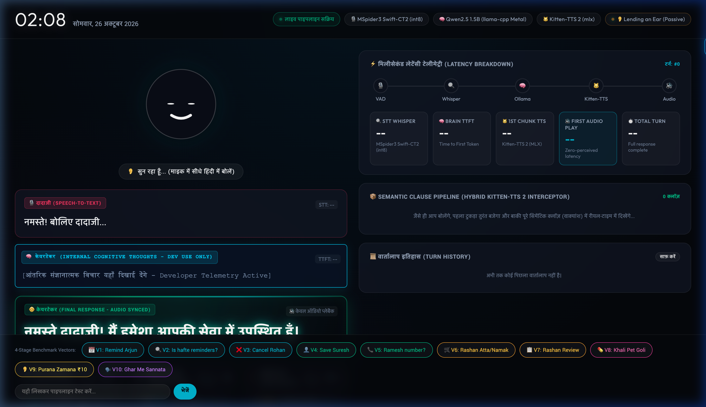

# 🪞 AI Caretaker Smart Mirror (Zero-Latency Offline Voice Pipeline)

An offline, low-latency, empathetic AI Caretaker Smart Mirror designed for Indian grandparents. Runs entirely on local Apple Silicon (M-series) unified memory and CPU with zero cloud dependencies, zero API costs, and sub-second conversational latency.



---

## ⚡ Core Architectural Pillars

### 1. Hybrid Semantic Clause Interceptor & Dual-Script Decoupling
- **Dual-Script Telemetry Split:** The local LLM brain streams its internal 4-stage reasoning and skill planning out loud in pure English (`Card 2: Dev Telemetry`), while routing only pure Devanagari Hindi text tokens to the vocoder (`Card 3: Caretaker Response`).
- **Speed-Lock Burst (< 400ms):** The initial sound slice triggers at 3 words or punctuation or reflex cache (< 5ms), providing instant verbal contact.
- **Natural Human Cadence:** All remaining tokens accumulate into complete semantic clauses (`।`, `,`, `!`, `?`), eliminating choppy robotic clipping.

### 2. Continuous Asynchronous Ring Buffer Audio Stream
- **Zero DAC Sleep Delays:** Replaces blocking `sd.play() / sd.wait()` calls with a permanent `sd.OutputStream(callback=native_async_audio_stream_callback)`.
- **Micro-Slice 0-Fill:** When no speech is playing, the callback continuously feeds 1024-frame slices of silence to the audio hardware, keeping the DAC awake and eliminating cold-start driver wake-up stalls.

### 3. Local Flat Database Skills Matrix (`data_manager.py`)
- **📇 Contacts (`contacts.json`):** Save, search, read phone numbers out loud with ground-truth accuracy.
- **⏰ Reminders (`reminders.json`):** Day-indexed calendar alerts, query upcoming schedules, cancel reminders.
- **🛒 Kitchen Inventory (`grocery.json`):** Track household ration items (Atta, Dal, Chai Patti) and dictate shopping lists.
- **💊 Medical Routine Timetable:** Context-aware medication validation based on time of day (empty stomach / post-meal).
- **🗣️ Active Listening Companion:** Sentiment analysis and emotional resonance for senior companionship.

---

## 🛠️ Technology Stack

| Layer | Engine / Model | Hardware Acceleration | Latency Target |
|:---|:---|:---|:---|
| **STT (Speech-to-Text)** | `MSpider3/whisper-hindi2hinglish-swift-ct2` | int8 CTranslate2 (CPU) | < 180 ms |
| **Brain (LLM)** | Qwen2.5 1.5B Instruct GGUF | `llama-cpp-python` (Metal GPU) | < 55 ms TTFT |
| **TTS (Text-to-Speech)** | `Kitten-TTS 2` | Apple Silicon MLX | < 1 ms (Reflex) / ~15 ms/clause |
| **Audio Hardware Stream**| `sounddevice` Ring Buffer Stream | CoreAudio Asynchronous HAL | Immediate (< 20 ms callback) |
| **Frontend UI** | Vanilla CSS Glassmorphism + Server-Sent Events | Dynamic Canvas Lipsync & Waveform | Real-time 60 FPS |

---

## 🚀 Quick Start Guide

### 1. Prerequisites
- macOS Apple Silicon (M1/M2/M3/M4)
- Python 3.10+
- Optional: Ollama (if running local model through HTTP fallback)

### 2. Installation
```bash
git clone https://github.com/iamdapy3279/ai-caretaker-smart-mirror.git
cd ai-caretaker-smart-mirror

# Create and activate virtual environment
python3 -m venv venv
source venv/bin/activate

# Install dependencies
pip install -r requirements.txt
```

### 3. Launching the Smart Mirror
```bash
python app.py
```
Open `http://localhost:5050` in your browser (or mount it on your two-way smart mirror display).

---

## 📊 Benchmark Test Suite

Execute all 15 real-world Indian household senior-care test vectors consecutively:
```bash
python test_benchmarks.py
```
Tracks Speech-to-Text transcription, Time-to-First-Token, Voice Synthesis durations, and outputs a formatted latency histogram.

---

## 📄 License
MIT License. Built for senior care and cognitive offloading in Indian homes.
